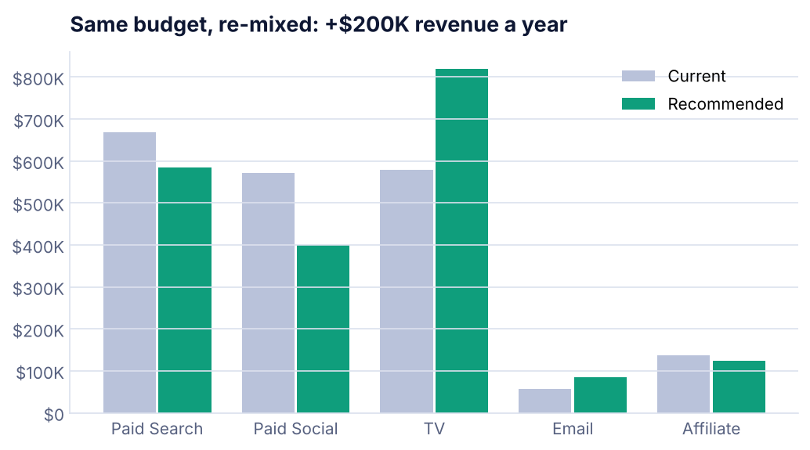
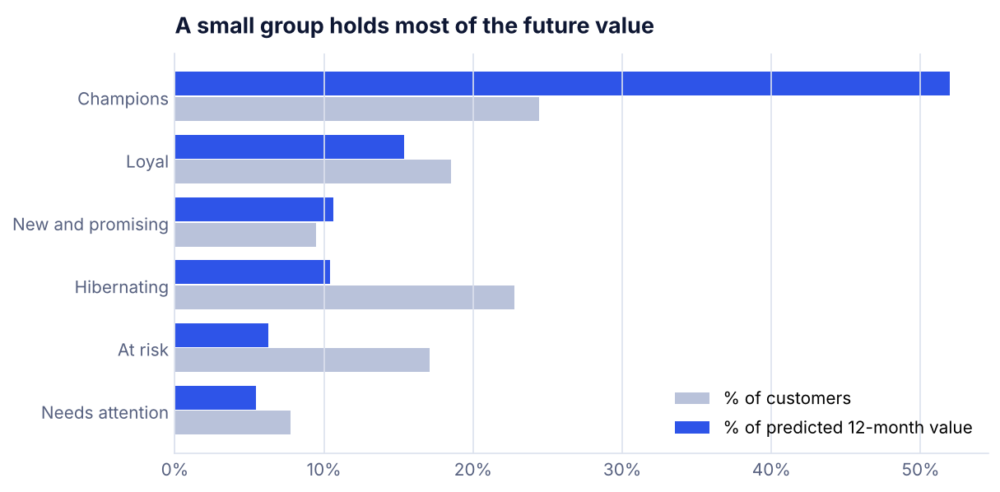
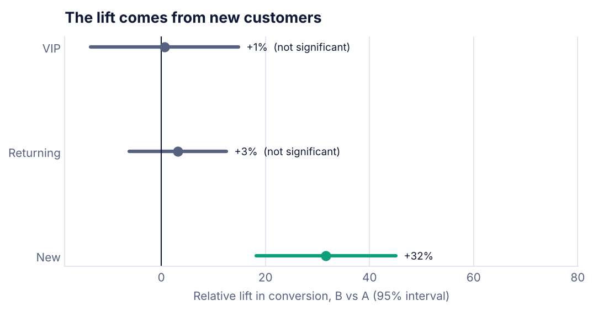

<p align="center">
  
</p>

<p align="center">
  <a href="https://anamikakumari.com"></a>
  <a href="https://www.linkedin.com/in/akumari4/"></a>
  <a href="mailto:akumari4@hawk.illinoistech.edu"></a>
</p>

### Hi, I'm Anamika 👋

I'm a marketing analyst who also runs campaigns. I measure what's working, find where money is leaking, and turn the numbers into the next decision.

- 📍 Chicago · open to relocating anywhere in the US
- 🎓 MS in Marketing Analytics, Illinois Institute of Technology (GPA 3.85)
- 💼 5+ years across B2B SaaS, ad tech, real estate and B2B distribution
- 🌱 Building **Market Makers**, a community on the stories and data behind great marketing

---

## 📊 Featured projects

Four end-to-end marketing analytics case studies. Each one starts with a business question, cleans messy data, checks its own model and ends with a recommendation and a dollar figure.

<table>
<tr>
<td width="50%" valign="top">
<a href="https://github.com/ana700433/ana700433/tree/main/projects/Marketing-Mix-Model"></a>
<h3><a href="https://github.com/ana700433/ana700433/tree/main/projects/Marketing-Mix-Model">Marketing Mix Model</a></h3>
Which of 5 channels really drive revenue, and where should a $2M budget go?<br>
<b>Same budget, re-mixed: +$200K revenue a year.</b> Checked on 16 holdout weeks (2.3% error).<br><br>
<code>Adstock</code> <code>Saturation curves</code> <code>Budget optimization</code> <code>SciPy</code>
</td>
<td width="50%" valign="top">
<a href="https://github.com/ana700433/ana700433/tree/main/projects/Multi-Touch-Attribution"></a>
<h3><a href="https://github.com/ana700433/ana700433/tree/main/projects/Multi-Touch-Attribution">Multi-Touch Attribution</a></h3>
Is Paid Search really closing 41% of sales, or finishing journeys others started?<br>
<b>Upper-funnel channels earn 39% of credit, not the 7% last click gives them.</b><br><br>
<code>Markov chains</code> <code>Removal effect</code> <code>6 attribution models</code>
</td>
</tr>
<tr>
<td width="50%" valign="top">
<a href="https://github.com/ana700433/ana700433/tree/main/projects/Customer-Segmentation-CLV"></a>
<h3><a href="https://github.com/ana700433/ana700433/tree/main/projects/Customer-Segmentation-CLV">Customer Segmentation and CLV</a></h3>
Who are the best customers, who is slipping away, and what is each group worth?<br>
<b>24% of customers hold 52% of future value.</b> Top 20% by score spent 3.3x the average.<br><br>
<code>RFM</code> <code>Cohort retention</code> <code>Lifetime value</code>
</td>
<td width="50%" valign="top">
<a href="https://github.com/ana700433/ana700433/tree/main/projects/AB-Test-Email-Campaign"></a>
<h3><a href="https://github.com/ana700433/ana700433/tree/main/projects/AB-Test-Email-Campaign">A/B Test: Email Campaign</a></h3>
Should a new email replace the old one?<br>
<b>Yes, for new customers only: +32% conversion, about $1.8M a year.</b><br><br>
<code>Power analysis</code> <code>Bayesian</code> <code>Bootstrap</code> <code>Holm correction</code>
</td>
</tr>
</table>

## 🗂️ More work

| Project | What it shows | Tools |
|---|---|---|
| [GA4 Drop-Off Analysis](https://github.com/ana700433/GA4-DropOff-Analysis) | Found a 78.1% drop from search to property pages and 98.8% CTA abandonment on a rental website | GA4, Python |
| [B2B Client Retention](https://github.com/ana700433/ana700433/tree/main/projects/B2B-Client-Retention-Analysis) | Data cleanup and lead work behind a 76% to 88% retention lift at a B2B SaaS company | SQL, CRM |
| [Compliance Reporting Automation](https://github.com/ana700433/ana700433/tree/main/projects/Compliance-Reporting-Automation) | Dashboards and a lease-notification flow that lifted audit efficiency 20% | Power BI, Power Automate |
| [Healthcare Gap Mapping](https://github.com/ana700433/Healthcare-Gap-Mapping) | Maps mental health provider shortages to find underserved regions | Python, Power BI |
| [Chicago Rental Market Dashboard](https://github.com/ana700433/ana700433/tree/main/projects/Chicago-Rental-Market-Dashboard) | Compares Chicago neighborhoods by rent level and price band | Tableau |
| [MimicPro Marketing Simulation](https://github.com/ana700433/MimicPro-Marketing-Simulation) | A/B testing and campaign optimization that boosted CTR by 35% | Excel, BI |
| [Startup Due Diligence Scorecard](https://github.com/ana700433/ana700433/tree/main/projects/Startup-Due-Diligence-Scorecard) | The scoring approach used to evaluate 50+ startups at IIT's Genisys program | Excel, market research |
| [Portfolio Website](https://github.com/ana700433/ana700433/tree/main/projects/portfolio-website) | Source for anamikakumari.com | HTML, CSS, JavaScript |

## 🧰 Toolkit

<p>
  
  
  
  
  
  
  
  
  
  
  
  
</p>

## 🌱 Building now: Market Makers

A community on the stories, data, founders and culture behind great marketing. The plan for the next 12 months:

```
●  Market Makers page    starting now
○  LinkedIn community    next
○  Substack page         next
○  Newsletter launch     within the year
◌  Podcast               later
```

---

<sub>About the featured projects: they use simulated data built to behave like real marketing data, including the mess. Because the true answers are known, each model can be graded against them, and each write-up says where the model was right and where it missed. Client and employer data never appear in this repo.</sub>
