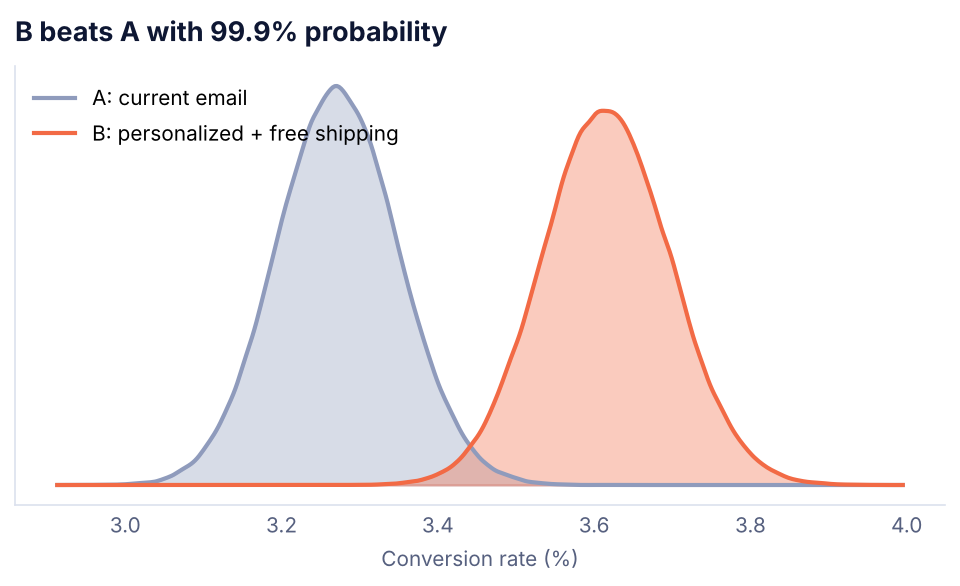
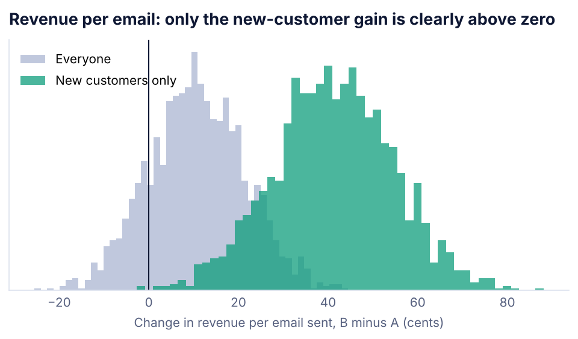

# A/B Test Readout: Email Campaign

**Question:** Should we replace the current campaign email with a new version (personalized subject line plus free shipping)?

**Answer:** **Yes, but only for new customers.** Version B lifts conversion by 10.5% overall, and the result is solid (p = 0.002). But almost all of that lift comes from new customers (+32%). For returning and VIP customers, B adds no orders while the free shipping still costs money. Sending B to new customers only is worth an expected **$1.8M a year** (95% range: $0.6M to $2.9M). Sending it to everyone is worth $1.0M, with a range that includes losing money.


## Results

| | A: current | B: new version |
|---|---|---|
| Recipients | 51,892 | 51,662 |
| Conversion rate | 3.27% | 3.61% |
| Revenue per email sent | $2.73 | $2.84 |

| Read | Result |
|---|---|
| Relative lift in conversion | +10.5% |
| 95% interval, absolute difference | +0.12 to +0.57 points |
| p-value | 0.002 |
| Bayesian probability B is better | 99.9% |
| Revenue per email, 95% interval | -$0.10 to +$0.32 (not proven) |



### By segment (Holm correction for testing 3 segments)

| Segment | A | B | Lift | 95% interval | Significant |
|---|---|---|---|---|---|
| New | 2.05% | 2.70% | +32% | +18% to +45% | Yes |
| Returning | 3.69% | 3.81% | +3% | -6% to +13% | No |
| VIP | 6.86% | 6.91% | +1% | -14% to +15% | No |



## How it works

1. **Plan before sending.** To detect a 10% lift on a 3.2% baseline, with 5% significance and 80% power, the test needs **49,777 recipients per version**. Both versions cleared that.
2. **Check the data before reading it.**
   - Removed 1,100 clicks from email security scanners.
   - Removed 700 duplicate sends.
   - Sample ratio check passed (p = 0.48): the 50/50 split held, so the randomization did not break.
3. **Three reads of the result.**
   - A two-proportion z-test.
   - A Beta-Binomial Bayesian model, which gives the probability that B is better.
   - A bootstrap on revenue per email, which is the number finance cares about.
4. **Segments without fishing.** Three segments were planned in advance. A Holm correction keeps a lucky segment from looking real.
5. **Decision.** Annual impact assumes 24 campaigns a year to a 400K list.

## What I would do next

- Run a follow-up test on returning customers with a cheaper incentive than free shipping.
- Watch unsubscribe rate and second-order rate for new customers who got version B.

## Run it

```bash
pip install -r ../requirements.txt
python ab_test.py
```

**Tools:** Python, pandas, NumPy, SciPy (z-test, power analysis, Beta posteriors, bootstrap), Matplotlib
