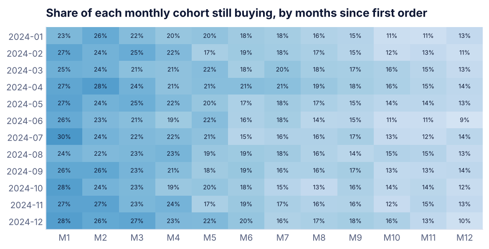
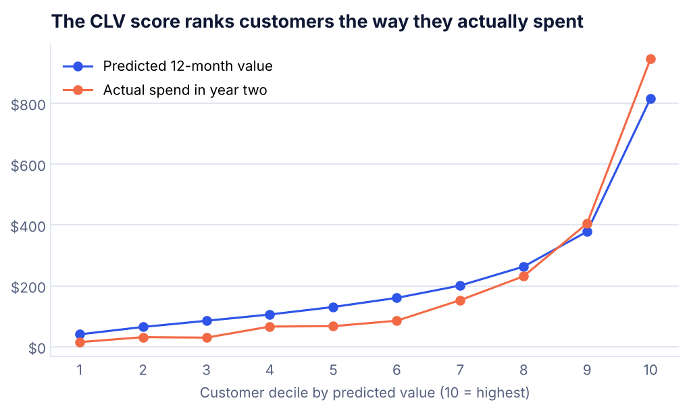

# Customer Segmentation and Lifetime Value

**Question:** An online retailer has a fixed retention budget. Who are the best customers, who is slipping away, and what is each group worth over the next 12 months?

**Answer:** **Champions are 24% of customers but hold 52% of predicted 12-month value.** They need recognition, not discounts. The 17% marked *At risk* bought often but have gone quiet for about 7 months, and they are the right target for a win-back series. *Hibernating* customers should be dropped from paid media to save spend.


## Segments and actions

| Segment | Customers | % of customers | % of future value | Avg 12-mo value | What to do |
|---|---|---|---|---|---|
| Champions | 1,142 | 24% | 52% | $478 | Early access and referral asks. No discounts needed. |
| New and promising | 444 | 10% | 11% | $251 | Second-order nudge within 30 days of first purchase. |
| Loyal | 867 | 19% | 15% | $186 | Cross-sell and a loyalty tier to move them up. |
| Needs attention | 362 | 8% | 5% | $157 | Reminder content and bestsellers, light incentive. |
| Hibernating | 1,067 | 23% | 10% | $102 | Low-cost reactivation only. Suppress from paid media. |
| At risk | 799 | 17% | 6% | $83 | Win-back series now, with a personal offer. |

## Retention

| Months after first order | Share of cohort still buying |
|---|---|
| 1 | 26% |
| 3 | 23% |
| 6 | 18% |
| 12 | 12% |



## Checking the CLV score

The model scores customers on year-one data, then gets checked against what they actually spent in year two.

| Check | Result |
|---|---|
| Predicted vs actual total, next 12 months | $1.05M vs $0.95M (11% high) |
| Correlation, predicted vs actual per customer | 0.63 |
| Spend of the top 20% by score, vs the average customer | 3.3x |



The score ranks customers well, which is what targeting needs. Two settings (how fast an inactive customer is assumed to churn, and how much to trust a single early order) were chosen while looking at year two. A production version should tune them on an earlier window to avoid that leak.

## How it works

1. **Data.** Two years of simulated orders for 8,000 customers with four hidden buying patterns.
2. **Cleaning.**
   - Removed 500 duplicate orders, 321 rows with no customer ID and 59 test orders.
   - Netted 1,535 returns against their original orders.
   - That left 37,045 clean orders.
3. **Cohorts.** Customers are grouped by first-order month and tracked month by month.
4. **RFM.** Each customer gets a 1 to 5 score for Recency, Frequency and Monetary value, then is mapped to a named segment.
5. **CLV.**
   - Expected orders = the customer's order rate × the chance they are still active.
   - The order rate is pulled toward the average customer, so one early order does not look like a habit.
   - The chance of being active decays with time since their last order.

## Run it

```bash
pip install -r ../requirements.txt
python segmentation.py
```

**Tools:** Python, pandas, NumPy, Matplotlib
