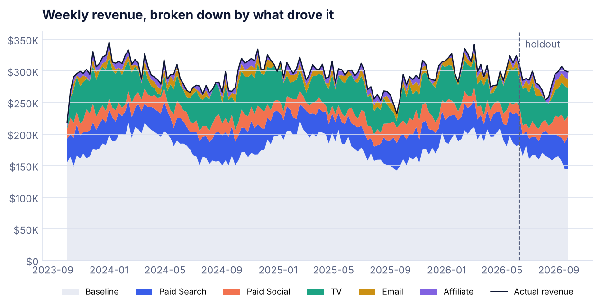
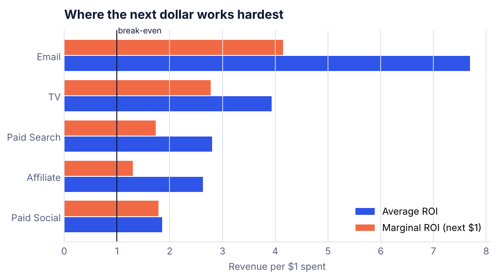
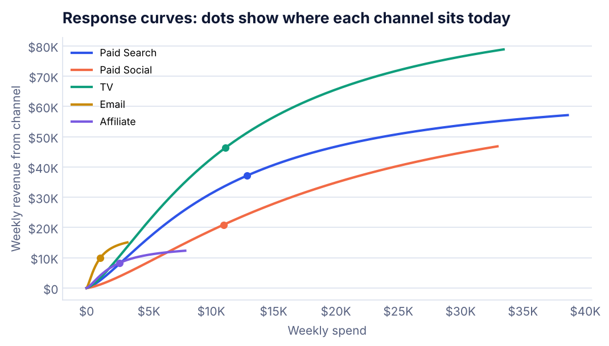

# Marketing Mix Model and Budget Optimizer

**Question:** A brand spends about $2M a year across five channels. Which channels actually drive revenue, and how should next year's budget move?

**Answer:** Shifting the same $2M budget toward TV and Email, and away from Paid Search and Paid Social, adds about **$200K in revenue a year** (+3.1% from media) at no extra cost. One caution before moving money out of Paid Social: the model undervalues it (see "Checking the model").



## Results

| Channel | Annual spend | ROI (model) | ROI (true) | Next-dollar ROI | Carryover |
|---|---|---|---|---|---|
| Email | $57K | 7.69 | 7.47 | 4.15 | 0.19 |
| TV | $580K | 3.93 | 4.10 | 2.78 | 0.72 |
| Paid Search | $669K | 2.80 | 3.65 | 1.74 | 0.28 |
| Affiliate | $137K | 2.63 | 2.89 | 1.30 | 0.16 |
| Paid Social | $571K | 1.86 | 3.41 | 1.79 | 0.43 |

- **Average ROI** answers "did this channel pay off?" **Next-dollar ROI** answers "where should the next dollar go?" They can rank channels differently.
- **TV** has the longest carryover. About 72% of a week's effect carries into the next week, so weekly last-click reports miss most of its value.
- **Email** has the highest return but saturates fast, so the recommendation raises it modestly rather than piling money in.

| | Current | Recommended | Change |
|---|---|---|---|
| Paid Search | $669K | $585K | -13% |
| Paid Social | $571K | $400K | -30% |
| TV | $580K | $820K | +41% |
| Email | $57K | $85K | +50% |
| Affiliate | $137K | $123K | -10% |


 

## How it works

1. **Data.** Three years of weekly spend and revenue. The data is simulated with known channel effects, so the model can be graded against the truth, which you cannot do with real data.
2. **Cleaning.** Removed 2 duplicated weeks, filled 3 missing email-spend weeks by interpolation, and fixed 1 row where refunds were booked as negative spend.
3. **Adstock.** Ads keep working after the week they run. Each channel gets a carryover rate.
4. **Saturation.** Each extra dollar does a little less than the one before. A Hill curve captures this.
5. **Fit.** All channels are fit together, with non-negative effects plus seasonality and price as controls. Weak priors on carryover (what is typical for each channel type) keep the model stable. Bayesian MMM tools like Google Meridian and PyMC-Marketing use the same idea.
6. **Validation.** The model trains on 140 weeks and predicts the last 16 weeks it never saw.
7. **Optimizer.** Keeps total spend fixed, allows each channel to move up to ±50%, and maximizes predicted revenue.

## Checking the model

| Check | Result |
|---|---|
| Fit on training weeks (R²) | 0.925 |
| Error on 16 unseen weeks (MAPE) | 2.3% |
| Channels with ROI within 15% of the truth | Email, TV, Affiliate |
| Biggest miss | Paid Social: 1.86 estimated vs 3.41 true |

Paid Social and Paid Search often run at the same time, and the model cannot fully separate them. This is the most common weakness of MMM. **Before cutting Paid Social by 30%, run a geo holdout test** (pause Social in a few regions for 4 to 6 weeks), then feed the measured lift back in as a prior.

## Run it

```bash
pip install -r ../requirements.txt
python mmm.py
```

Writes `charts/`, `data/weekly_marketing.csv` and `results.json`. The random seed is fixed, so results match this page.

**Tools:** Python, pandas, NumPy, SciPy (non-negative least squares, constrained optimization), Matplotlib
