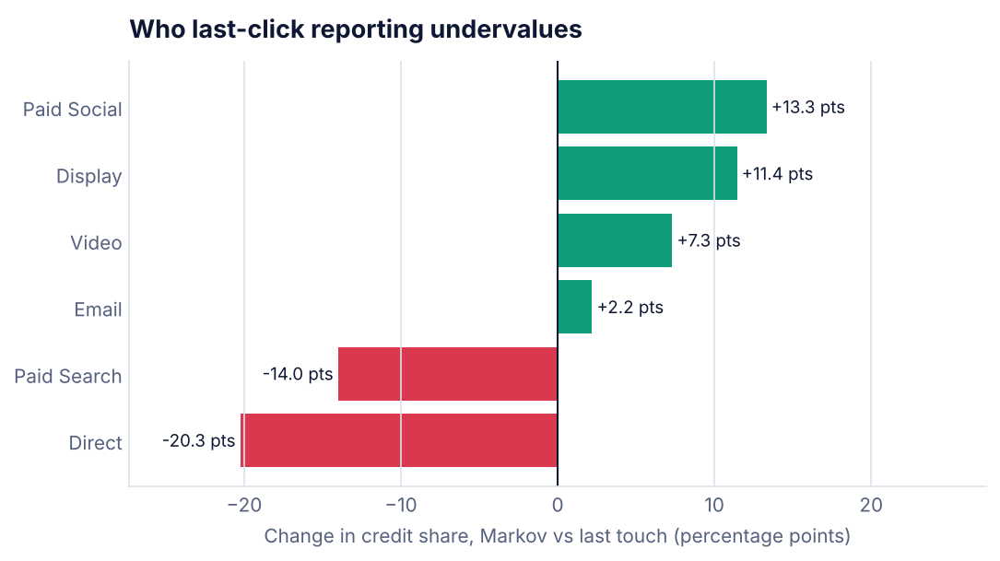
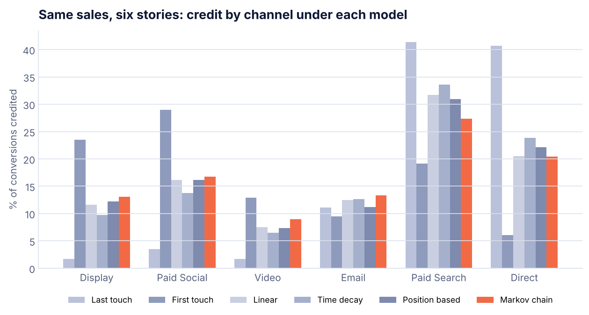
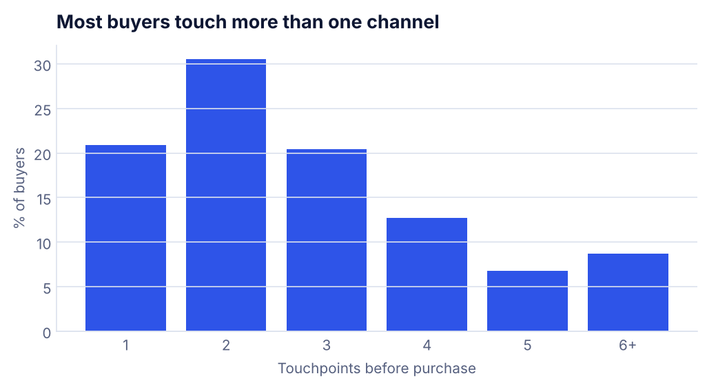

# Multi-Touch Attribution: Last Click vs Markov Chain

**Question:** Last-click reporting says Paid Search and Direct drive 82% of sales. Is that true, or are they just the last stop on journeys other channels started?

**Answer:** Mostly the last stop. A data-driven Markov model gives **Display, Paid Social and Video 39% of the credit**, against **7% under last click**. Paid Search still matters most, but its share falls from 41% to 27%. Budget decisions based on last click would starve the channels that fill the funnel.



## Results

Share of 5,746 conversions credited to each channel:

| Channel | Last touch | First touch | Linear | Time decay | Position 40/20/40 | **Markov** |
|---|---|---|---|---|---|---|
| Display | 1.7% | 23.5% | 11.7% | 9.7% | 12.2% | **13.1%** |
| Paid Social | 3.5% | 29.0% | 16.2% | 13.7% | 16.2% | **16.8%** |
| Video | 1.7% | 12.9% | 7.5% | 6.5% | 7.3% | **9.0%** |
| Email | 11.1% | 9.5% | 12.5% | 12.7% | 11.2% | **13.3%** |
| Paid Search | 41.4% | 19.1% | 31.7% | 33.6% | 30.9% | **27.4%** |
| Direct | 40.7% | 6.0% | 20.5% | 23.9% | 22.1% | **20.4%** |

- **79%** of buyers touched more than one channel before purchasing. The median was 2 touches.
- **Removal effect:** taking Paid Search out of the journey would cut conversions by 64%. Removing Paid Social would cut them by 39%, and Display by 31%.
- Rule-based models disagree with each other by up to 35 points for the same channel. The Markov model settles it with the data instead of a rule someone picked.



## How it works

1. **Data.** 60,000 simulated customer journeys across 6 channels. Upper-funnel channels start journeys more often; Search, Email and Direct close them more often.
2. **Cleaning.**
   - Removed 2,487 rows from 900 bot users.
   - Collapsed 3,946 duplicate clicks (same user, channel and time).
   - Dropped 1,341 touches older than a 30-day lookback window.
3. **Rule-based models.** First touch, last touch, linear, time decay (7-day half-life) and position based (40/20/40).
4. **Markov chain model.**
   - Builds a transition matrix from every path, including paths that never converted.
   - Removes each channel in turn and measures how much the overall conversion probability drops (the *removal effect*).
   - Credit is shared in proportion to those drops.



## What I would do next

- Shift some budget from Search toward Social and Display, then check the move with a holdout test.
- Pair this with the [Marketing Mix Model](../Marketing-Mix-Model). Attribution works at the user level for digital channels. MMM covers TV and offline, and it is not affected by cookie loss.

## Run it

```bash
pip install -r ../requirements.txt
python attribution.py
```

**Tools:** Python, pandas, NumPy (absorbing Markov chains), Matplotlib
